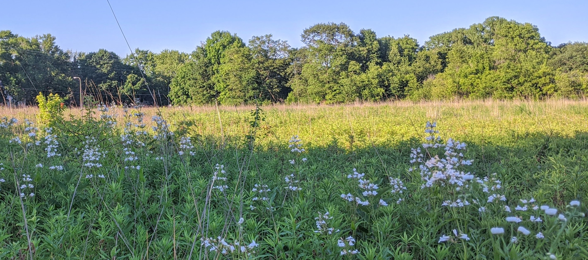

 

   

I am an evolutionary ecologist studying how microbial symbioses shape plant responses to global change. Plants do not persist or spread on their own: their fitness and phenotype are shaped by their microbial symbionts. Yet as plants and microbes both adapt to climate change and other anthropogenic stressors, the benefits these partnerships confer may shift, limiting our ability to predict how plants will respond to these changes.  My research fills this gap, using empirical approaches to link plant-microbe dynamics with plant fitness, competition, and range shifts in a rapidly changing global environment. 

I am currently a Postdoctoral Fellow with [Megan Frederickson](http://mutualism.ca/) in the Department of Ecology and Evolutionary Biology at the University of Toronto and I completed my PhD with [Anthony Yannarell](https://nres.illinois.edu/directory/acyann) at the University of Illinois. 

